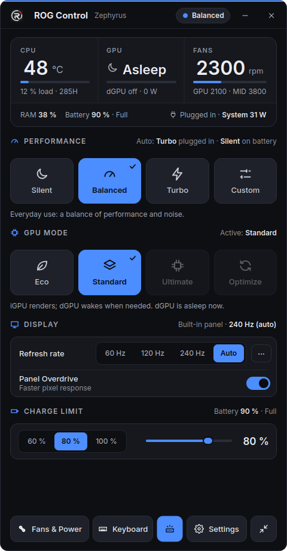
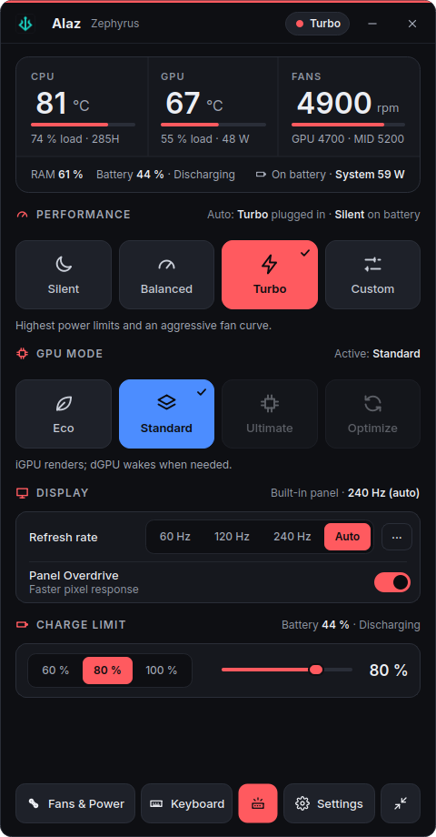
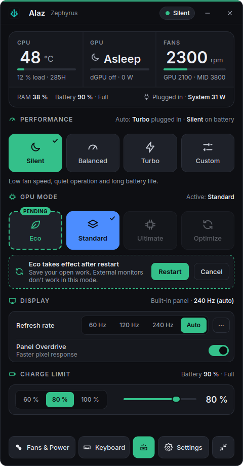
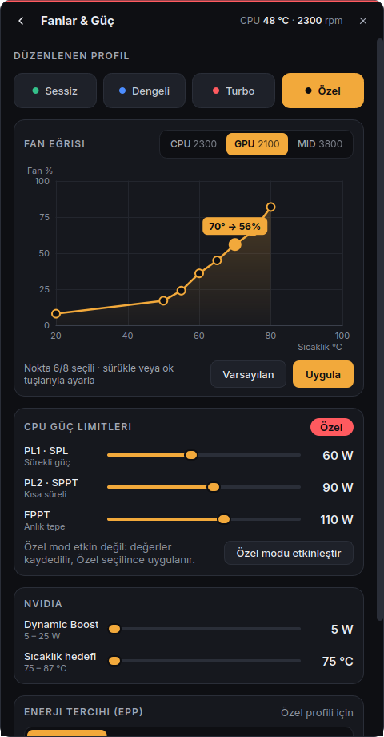
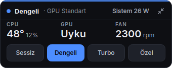
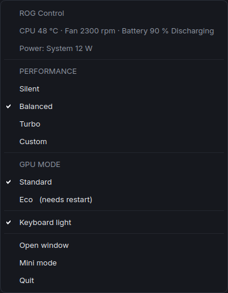
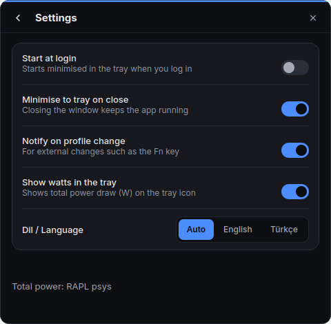

<p align="center"></p>

# Alaz

A [G-Helper](https://github.com/seerge/g-helper)-inspired control centre for ASUS ROG laptops on Linux, built on top of `asusd` and `supergfxd`.

*Formerly ROG Control.* Alaz means "flame" in Old Turkish. It is an independent project, not affiliated with ASUS; ASUS and ROG are trademarks of ASUSTeK Computer Inc.

[](.github/workflows/tests.yml)
[](LICENSE)

English | [Türkçe](README.tr.md)

> **Status: early, tested on one machine.** Developed and verified on an ASUS ROG Zephyrus (2025) with Core Ultra 9 285H and RTX 5070 Laptop on Zorin OS 18 (GNOME, Wayland). Other models may behave differently. See [Safety and limitations](#8-safety-and-limitations).
>
> **The interface is available in English and Turkish.** The language follows your system locale (Turkish if it starts with `tr`, otherwise English); change it under Settings → Language (applies after a restart). More translations are welcome: see `alaz/i18n.py` and `alaz/i18n_en.py`.

<p align="center">
  
  
</p>

## 1. Screenshots

| | |
|---|---|
|  Eco selected, applying at next boot (the fallback when live switching is not installed) |  Fan curve editor, power limits, NVIDIA, EPP |
|  Mini window |  Tray menu |
|  Keyboard brightness and colour |  Settings |

The screenshots are rendered with fake data (`tools/screenshot_windows.py`), so the model name and sensor values are placeholders.

## 2. Features

- **Performance modes:** Silent, Balanced, Turbo (asusd thermal policies) and **Custom** (an app-level mode: Turbo policy plus your own limits).
- **Custom power limits:** PL1 (SPL, 15 to 120 W), PL2 (SPPT, 15 to 150 W) and FPPT (15 to 170 W); defaults 60/90/110 W, applied only in Custom mode.
- **Fan curve editor:** 8 draggable points per fan (CPU, GPU, MID where present), per profile, with reset to defaults. Custom mode shares Turbo's fan curves.
- **NVIDIA Dynamic Boost and temperature target** sliders (asusd properties).
- **EPP** (energy performance preference) per profile.
- **AC/battery auto profile:** pick a profile to apply when plugged in and another on battery.
- **GPU modes:**
  - **Eco and Standard switch live, without a reboot** (about 10 to 13 s) through Alaz's own root helper, never through `supergfxctl -m` (see [why](#4-why-this-exists-what-we-learned)). This needs the optional helper install plus a re-login (see [Install](#6-install)); otherwise Alaz falls back to applying the change at the next boot.
  - **Optimize:** Standard on AC, Eco on battery, switched automatically (5 s debounce). If an app is using the dGPU it waits until the app closes; it never kills anything and never reboots.
  - **Ultimate (MUX, dGPU direct)** is written through asusd and needs a reboot. The code is done but not yet tested on real hardware, and it comes with a risk warning dialog.
  - If an app is using the dGPU, a live switch is refused and Alaz lets you wait for it to close, apply at next reboot, or cancel.
- **Refresh rate** of the internal panel only (never an external monitor), plus an Auto setting: highest rate on AC, 60 Hz on battery.
- **Panel Overdrive** toggle.
- **Battery charge limit** (20 to 100 %).
- **Keyboard** brightness and colour (Aura static colour).
- **Live sensors without waking the dGPU:** CPU/GPU temperature and load, fan RPM, RAM, battery.
- **Total system power** via the RAPL `psys` counter (watts on AC and battery).
- **Tray icon** with live watts, a profile and GPU-mode menu, and a compact **mini window**.
- Single instance, optional autostart (minimised to tray), optional notifications when the profile is changed externally (for example with the Fn key).

## 3. Requirements

- An ASUS ROG / TUF laptop supported by [`asusctl`](https://asus-linux.org). `asusd` (tested 6.0.12) and `supergfxd` (tested 5.2.7) must be installed and running.
- Python 3 with PyQt6 (including QtDBus) and `psutil`. Developed on Python 3.12 and PyQt6 6.6 / Qt 6.4; `pyproject.toml` declares Python 3.10 or newer, PyQt6 6.4 or newer.
  On Ubuntu-based distributions: `sudo apt install python3-pyqt6 python3-psutil`.
- GNOME on Wayland or X11 for the refresh-rate control (it uses Mutter's DisplayConfig D-Bus API, or `xrandr` on X11). Other compositors are untested.
- Optional: `polkit`/`pkexec` and the privileged helper (below) for GPU mode switching.

## 4. Why this exists: what we learned

Most existing tools switch the GPU live with `supergfxctl`. On this hardware that breaks the session, and getting reliable Eco mode (first at boot, later live) meant finding a chain of unrelated problems. This is the condensed result; every item is written up with commands and rollbacks in **[docs/SYSTEM_SETUP.md](docs/SYSTEM_SETUP.md)**. All of it was verified only on the reference machine above.

- **`supergfxctl -m` breaks GNOME.** While the session runs it killed gnome-shell and Xwayland when entering Eco, and froze Wayland gnome-shell when leaving it. Alaz never calls it.
- **Live switching works once the compositor stays off the NVIDIA card.** The root causes were mutter opening the NVIDIA DRM card and gnome-shell/Xwayland loading NVIDIA EGL. Two udev rules (mutter ignores the NVIDIA card; no `uaccess` ACL on the NVIDIA render node) and a session variable that points EGL at Mesa fix that, and `/dev/nvidia*` stays accessible, so GLX/EGL/Vulkan/CUDA offload still works. During a switch the helper also masks Ubuntu's `71-nvidia.rules` (otherwise udev loads and unloads the driver in an endless loop) and always undoes that. Design: [docs/LIVE_GPU_CONTRACT.md](docs/LIVE_GPU_CONTRACT.md).
- **Entering Eco:** set `"mode": "Integrated"` in `/etc/supergfxd.conf` and reboot.
- **Leaving Eco (the trick):** supergfxd refuses to leave Eco on its own (it forces Integrated again when it sees `dgpu_disable=1`). The working sequence is: stop supergfxd, set `/sys/bus/pci/drivers_autoprobe` to `0`, set the config mode to Hybrid, write `dgpu_disable=0`, **reboot**. The card comes back with no driver bound, so no new GPU appears while the desktop runs.
- **Plymouth made Eco entry racy.** The boot splash opened the NVIDIA DRM device (the only one present at about 4.5 s), so supergfxd's `rmmod nvidia` failed with "module in use" and Eco ended half-done. Removing `splash` from the kernel command line fixed it, at the price of a boot that is about 6.5 s longer.
- **Ubuntu's `gpu-manager` races supergfxd.** Both want to own GPU state; one boot ended in a deadlock inside `nv_pci_remove`. Mask `gpu-manager.service`.
- **`power-profiles-daemon` and `asusd` fight** over `platform_profile`. Mask power-profiles-daemon and let asusd own profiles.
- **Polling `nvidia-smi` keeps the dGPU awake.** The app only calls it when the device is already active and a real process holds `/dev/nvidiaN`. Compositors keep that node open permanently without waking the GPU, so they do not count.
- **Windows dual boot** can leave `dgpu_disable=1` (G-Helper's Eco). Set supergfxd `hotplug_type` to `Asus` so Linux adopts that state instead of fighting it.
- **Realtek card reader:** on this model ASPM produces PCIe AER error floods, so `pcie_aspm=off` is needed. Do not remove it on this model.
- **`GRUB_DEFAULT` by name**, not by index, so a changed menu cannot land on "UEFI Firmware Settings".

## 5. Tech stack and architecture

- **Python 3.12, PyQt6 (Qt 6.4).** The GUI thread never blocks: all D-Bus calls use QtDBus asynchronously; `subprocess` and slow I/O run in worker threads.
- **D-Bus APIs:** asusd (`org.asuslinux.Daemon`: Platform, FanCurves, Aura) and supergfxd (`org.supergfxctl.Daemon`, read-only; its `SetMode` and `SetConfig` are deliberately never called).
- **Sensors:** `psutil` plus sysfs/hwmon, RAPL via `powercap`.
- **Display:** Mutter `org.gnome.Mutter.DisplayConfig` over D-Bus, or `xrandr` on X11.
- **Privilege:** polkit + `pkexec` helper, used only for the GPU mode (boot-mode config, Eco exit and the live Eco/Standard switch); a udev rule exposes only the RAPL `psys` counter.

```
alaz/
├── app.py, __main__.py   entry point, single instance, tray, wiring
├── backend/              asusd.py, gfx.py, sensors.py, display.py, dbus_util.py, types.py
├── core/                 state.py (AppState: data + signals), controller.py (the only write path)
└── ui/                   theme.py, widgets/ (tiles, fan chart, cards, controls), windows/
helper/
├── alaz-gfx-helper         root helper (stdlib only)
├── org.alaz.gfx.policy      polkit action
├── 90-alaz-rapl.rules      udev rule (RAPL psys only)
├── 61-…/72-… .rules        udev rules for live GPU switching
└── install.sh / uninstall.sh      privileged install, run with sudo
tests/                             pytest, offscreen Qt
tools/                             screenshot and widget gallery scripts
```

The windows read `AppState` and call `Controller`; they never talk to the backends directly. Every write is wrapped in busy/error reporting. See [docs/ARCHITECTURE.md](docs/ARCHITECTURE.md) for the module contracts (currently written in Turkish).

## 6. Install

### The app (no sudo)

```bash
git clone https://github.com/n3vrb/alaz.git
cd alaz
./install.sh
```

This installs the app under `~/.local/share/alaz`, a launcher `~/.local/bin/alaz`, a desktop entry and an icon, and (when Mesa's EGL vendor file exists) `~/.config/environment.d/90-alaz-egl-mesa.conf`, which live GPU switching needs. Make sure `~/.local/bin` is on your `PATH`.

### Start at login

```bash
./install.sh --autostart                  # installs and enables the systemd user service
journalctl --user -u alaz -f       # logs
systemctl --user restart alaz      # restart
systemctl --user disable --now alaz   # turn off (or use the toggle in Settings)
```

The service starts the app minimised to the tray after login (it waits up to 20 s for the tray host). Add `--start` to also start it right away.

### First run

Start **Alaz** from the application menu, or run `alaz`. Performance modes, fan curves, power limits, display and keyboard controls work as soon as `asusd` is running. GPU mode switching and the total-power readout need the optional part below. **For live Eco/Standard switching run `sudo ./helper/install.sh` and then log out and back in** (the environment snippet is only read at login).

### Optional privileged helper (needs sudo)

```bash
sudo ./helper/install.sh
```

It installs these files:

| File | Purpose |
|---|---|
| `/usr/local/libexec/alaz-gfx-helper` | root helper, run through `pkexec` |
| `/usr/share/polkit-1/actions/org.alaz.gfx.policy` | polkit action (`auth_admin_keep`) |
| `/etc/udev/rules.d/90-alaz-rapl.rules` | makes the RAPL `psys` counter readable |
| `/etc/udev/rules.d/61-alaz-mutter-ignore-nvidia.rules` | mutter ignores the NVIDIA DRM card (only when the MUX is Optimus) |
| `/etc/udev/rules.d/72-alaz-nvidia-render-noaccess.rules` | no `uaccess` ACL on the NVIDIA render node (MUX Optimus only) |
| `/etc/udev/rules.d/70-alaz-peripherals.rules` | access to supported peripherals (Devices window) |

The polkit file declares three actions (`set-boot-mode`, `live-eco`, `live-hybrid`); the live ones do not ask for a password in an active local session.

**What the helper can do:** edit only the `"mode"` key of `/etc/supergfxd.conf` (Integrated or Hybrid), atomically with a backup; run the tested Eco-exit sequence for the boot path; and do the live switch (`live-eco` / `live-hybrid`: unload or load the NVIDIA modules, remove or rescan the PCI device, write `dgpu_disable`), plus a read-only `holders` listing of processes using the dGPU. It refuses a symlinked config, validates all input, refuses live switching when the MUX is dGPU direct or the udev rule is missing, and refuses when a process holds the dGPU (it never kills anything).

**What it cannot / does not do:** it never calls `supergfxctl`, never kills a process, never reboots (the app asks you, then reboots through logind), and runs only fixed system tools by absolute path (`systemctl`, `modprobe`, `udevadm`), with a clean environment and no shell.

**Security notes**

- Boot-time GPU changes ask for administrator authentication (`auth_admin_keep`: remembered for a short while). Live switches (`live-eco`, `live-hybrid`) are allowed without a password for the active local session, because they can only move between Eco and Standard and refuse when apps use the GPU; remove or edit the policy file if you prefer a prompt.
- The udev rule makes `energy_uj` of the `psys` RAPL domain world-readable; package, core and DRAM domains are not touched. World-readable RAPL energy counters have been used in side-channel research (PLATYPUS); the exposure is limited to the platform counter, but if that concerns you, skip the helper's udev rule (delete it; the system-power reading will then be unavailable).

### Uninstall

```bash
./uninstall.sh                 # the app (settings kept)
sudo ./helper/uninstall.sh     # the optional privileged part, if installed
```

## 7. Recommended system setup

These make GPU switching and profiles reliable. All are optional, and **all boot-related changes are at your own risk**: a wrong GRUB or driver-loading change can produce a black screen. Keep a live USB at hand, and read the rollback before each step in **[docs/SYSTEM_SETUP.md](docs/SYSTEM_SETUP.md)**.

1. Align the NVIDIA kernel module and user-space versions (reboot after upgrades).
2. `/etc/supergfxd.conf`: `"hotplug_type": "Asus"`, `"always_reboot": true`.
3. `sudo systemctl mask power-profiles-daemon`
4. `sudo systemctl mask gpu-manager.service` (Ubuntu-based systems).
5. Remove `splash` from `GRUB_CMDLINE_LINUX_DEFAULT` (keep `quiet`), then `sudo update-grub`.
6. Dual boot: set `GRUB_DEFAULT` by entry name.
7. Keep `pcie_aspm=off` if your model needs it (it did on the reference machine).

Section 7d of the guide covers the live-switching setup (what gets installed, how to verify it, side effects, rollback). It also lists what **not** to do: live `supergfxctl -m`, blacklisting NVIDIA autoload (four black-screen boots), and a supergfxd wait drop-in (adds 20 s to every boot).

## 8. Safety and limitations

- **Only one model tested.** Treat everything else as unverified. Bug reports from other models are valuable.
- **Live switching needs the helper install and a re-login**, and only works while the MUX is in Optimus (Standard/Eco) mode. Without that, leaving Eco falls back to an immediate reboot (the dGPU is re-enabled with no driver bound and `drivers_autoprobe` stays `0` until then); the app prompts for it.
- **Apps using the dGPU block a live switch.** Nothing is killed: you can wait for them to close, apply at next reboot, or cancel.
- **Ports wired to the dGPU** (on the reference machine one HDMI and one DisplayPort) give no external display in Eco, and with the live-switching udev rule also not in Standard.
- **EGL-only apps run on the iGPU by default** (for example the Blender viewport on Wayland). To use the dGPU, launch them with `__EGL_VENDOR_LIBRARY_FILENAMES=/usr/share/glvnd/egl_vendor.d/10_nvidia.json`; GNOME's "Launch using discrete GPU" does not set it. CUDA/OptiX rendering is unaffected.
- **Open items:** Ultimate (MUX) is untested on hardware; a live Eco switch with an external monitor connected is still to be tested (the internal panel came back on by itself in one run). See [docs/TODO.md](docs/TODO.md).
- **Removing `splash` costs about 6.5 s of boot time** on the reference machine.
- **Custom mode shares Turbo's fan curves** (it uses the Performance policy). Leaving Custom writes only the policy; whether the firmware then restores its own limits was not verified.
- Idle draw on the reference machine is about 15 to 16 W on battery (measured; the RAPL `psys` reading is 1 to 2 W higher). `pcie_aspm=off` likely costs some of it but is required on this model (see above).
- `nvidia-powerd` was not installed on the reference machine, and Dynamic Boost depends on it; the effect of the Dynamic Boost slider there was not investigated.
- The interface is available in English and Turkish only (Settings → Language; other languages are welcome as contributions).

## 9. Development

```bash
python3 -m venv .venv --system-site-packages   # or install PyQt6 and psutil in your own venv
QT_QPA_PLATFORM=offscreen python3 -m pytest tests
QT_QPA_PLATFORM=offscreen python3 tools/screenshot_windows.py docs/screenshots --lang en   # render windows with fake state
```

The suite has 591 tests (backends, core controller and state, widgets, windows, the root helper) and runs offscreen. **Tests never write to the real system**; write paths are exercised with mocks, fakes and a re-rooted helper (`ALAZ_HELPER_TESTROOT`, honoured only when not root).

Ground rules for contributions (from [docs/ARCHITECTURE.md](docs/ARCHITECTURE.md)): never block the GUI thread; never call `supergfxctl -m` or supergfxd `SetMode`/`SetConfig` (live switching goes only through the helper, see [docs/LIVE_GPU_CONTRACT.md](docs/LIVE_GPU_CONTRACT.md)); do not wake the dGPU for monitoring; unreadable values become `None` and show as an em dash, never an invented number; use `logging`, not `print`. Add or update tests with your change. Pull requests are welcome, especially: translations, other ROG models, Ultimate/MUX testing, other desktop environments.

### How it was built

This project was designed and orchestrated with Anthropic's Claude: an orchestrator model split the work into waves, delegated each module to Claude Sonnet sub-agents under written contracts, and reviewed their output and tests. The human owner tested everything on real hardware and made the product decisions. The system findings in this README came from that real-hardware testing, not from guesswork.

## 10. Credits

- [asusctl / asusd and supergfxctl](https://asus-linux.org): the asus-linux.org project; Alaz is only a front end for their daemons.
- [G-Helper](https://github.com/seerge/g-helper) by seerge, the inspiration for the feature set and the look.
- IBM Plex Sans, used as the design reference for the typography.

## License

GPL-3.0. See [LICENSE](LICENSE).
